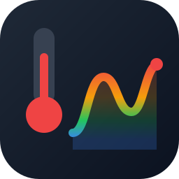
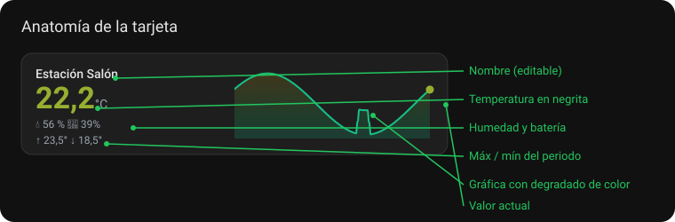
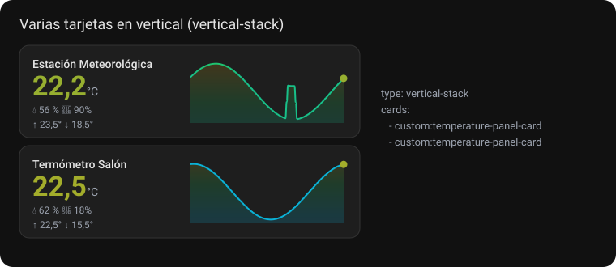
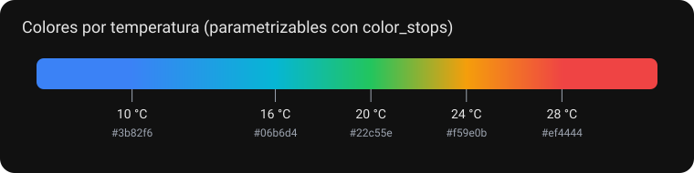

<p align="center"></p>

# Temperature Panel Card

Tarjeta Lovelace para Home Assistant con diseño **horizontal y limpio**: nombre, temperatura, humedad, batería y una **gráfica cuyo color cambia según la temperatura** (degradado vertical). Muestra el **máx/mín** del periodo.

<p align="center"></p>

## Instalación (HACS)

1. HACS → ⋮ → **Repositorios personalizados**.
2. Añade `https://github.com/guaisess/temperature-panel-card` con tipo **Dashboard** (Lovelace).
3. Instala **Temperature Panel Card** y recarga el navegador.

Manual: copia `dist/temperature-panel-card.js` a `/config/www/` y añádelo como recurso `/local/temperature-panel-card.js` (módulo JavaScript).

## Uso

Se puede añadir desde el selector de tarjetas (editor visual) o por YAML:

```yaml
type: custom:temperature-panel-card
entity: sensor.salon_temperatura
name: Estación
humidity: sensor.salon_humedad
battery: sensor.salon_bateria
hours: 24
```

### Varias tarjetas en vertical

Usa `vertical-stack` de HA:

<p align="center"></p>

```yaml
type: vertical-stack
cards:
  - type: custom:temperature-panel-card
    entity: sensor.salon_estacion_temperatura
    name: Estación
  - type: custom:temperature-panel-card
    entity: sensor.salon_termometro_temperatura
    name: Termómetro
    humidity: sensor.salon_termometro_humedad
    battery: sensor.salon_termometro_bateria
```

## Opciones

| Opción | Defecto | Descripción |
|---|---|---|
| `entity` | — (obligatoria) | Sensor de temperatura |
| `name` | nombre de la entidad | Nombre mostrado |
| `humidity` | — | Sensor de humedad |
| `battery` | — | Sensor de batería |
| `hours` | `24` | Horas de histórico de la gráfica |
| `decimals` | `1` | Decimales de la temperatura |
| `graph_height` | `70` | Alto de la gráfica (px) |
| `refresh_minutes` | `10` | Cada cuántos minutos se recarga el histórico |
| `show_graph` / `show_minmax` / `show_humidity` / `show_battery` / `show_current_dot` | `true` | Mostrar/ocultar elementos |
| `battery_low` | `20` | % bajo el cual la batería se marca en rojo |
| `line_width` | `2` | Grosor de la línea |
| `area_opacity` | `0.18` | Opacidad del relleno bajo la línea |
| `color_stops` | ver abajo | Umbrales de color: lista de `{temp, color}` (editor visual o YAML) |

### Colores por temperatura

La gráfica se colorea con un degradado: cada altura toma el color de su temperatura. Los colores y umbrales son **parametrizables**, desde el editor visual (sección *Colores de la gráfica*) o en YAML con `color_stops`. Por defecto:

<p align="center"></p>

| °C | Color |
|---|---|
| ≤10 | `#3b82f6` azul |
| 16 | `#06b6d4` cian |
| 20 | `#22c55e` verde |
| 24 | `#f59e0b` naranja |
| ≥28 | `#ef4444` rojo |

Personalización (colores en hex `#rrggbb`; se pueden poner los umbrales que se quieran):

```yaml
color_stops:
  - { temp: 5, color: "#60a5fa" }
  - { temp: 22, color: "#22c55e" }
  - { temp: 30, color: "#dc2626" }
```

## Desarrollo

Código en `src/` (ficheros pequeños, un fichero por responsabilidad; todos los valores en `src/config.js`). El fichero distribuible se genera con:

```bash
npm run build
```

| Fichero | Función |
|---|---|
| `config.js` | Configuración y valores por defecto |
| `i18n.js` | Textos es/en |
| `color-scale.js` | Escala de color por temperatura |
| `history-service.js` | Histórico vía WebSocket + caché |
| `stats.js` | Máx/mín y reducción de puntos |
| `sparkline-chart.js` | Generación del SVG |
| `styles.js` | CSS |
| `card.js` / `editor.js` / `index.js` | Tarjeta, editor y registro |

Las imágenes de `docs/images/` se regeneran con `node scripts/make-docs-images.mjs`.

Versionado `AAAA.MM.V` (ver [CHANGELOG](CHANGELOG.md)).

## Licencia

MIT
